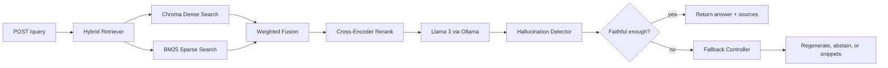

# RAG Hallucination Detector

[](https://www.python.org/)
[](https://fastapi.tiangolo.com/)
[](https://ollama.ai/)
[](https://trychroma.com/)
[](https://mlflow.org/)
[](https://www.docker.com/)
[](LICENSE)


Production-oriented FastAPI backend for Retrieval-Augmented Generation with real-time hallucination detection, threshold-based fallback control, MLflow tracking, and Docker support.

The API uses:

- Local LLM: Llama 3 through Ollama
- Dense retrieval: ChromaDB plus sentence-transformers embeddings
- Sparse retrieval: BM25
- Fusion and reranking: weighted dense/sparse fusion plus cross-encoder reranking
- Hallucination detection: semantic answer-context similarity, sentence-level support, and cross-encoder verification
- Evaluation: local detector metrics, optional RAGAS metrics, and MLflow logging

## Architecture



## Quick Start

Install and start Ollama, then pull Llama 3:

```bash
ollama pull llama3
ollama serve
```

Create a Python environment and install dependencies:

```bash
cd rag_hallucination_detector
python -m venv .venv
.venv\Scripts\activate
pip install -r requirements.txt
```

Run the API:

```bash
uvicorn app.main:app --reload --host 0.0.0.0 --port 8000
```

The service bootstraps `data/sample_docs.jsonl` into Chroma on first startup.

Try a query:

```bash
curl -X POST http://localhost:8000/query ^
  -H "Content-Type: application/json" ^
  -d "{\"query\":\"How does fallback work in this RAG system?\"}"
```

## API

### `POST /query`

Request:

```json
{
  "query": "How does fallback work?",
  "top_k": 5,
  "stream": false
}
```

Response:

```json
{
  "answer": "string",
  "sources": [],
  "faithfulness_score": 0.82,
  "hallucination_detected": false,
  "fallback_triggered": false,
  "latency_ms": 1432,
  "confidence": 0.79,
  "detection_details": {
    "semantic_similarity": 0.78,
    "sentence_support": 1.0,
    "verification_score": 0.69
  }
}
```

For basic SSE streaming, pass `"stream": true`. Streaming returns generation tokens directly from Ollama; post-generation detection is used by the normal non-streaming path.

### `POST /ingest`

```json
{
  "documents": [
    {
      "id": "internal-policy-1",
      "text": "Your source document text",
      "metadata": {
        "source": "policy"
      }
    }
  ]
}
```

### `GET /health`

Returns service health and indexed document count.

## Configuration

Settings are read from environment variables with the `RAG_` prefix.

Important variables:

- `RAG_OLLAMA_BASE_URL`: Ollama endpoint, default `http://localhost:11434`
- `RAG_OLLAMA_MODEL`: default `llama3`
- `RAG_FAITHFULNESS_THRESHOLD`: main fallback threshold, default `0.62`
- `RAG_SIMILARITY_THRESHOLD`: minimum semantic grounding threshold
- `RAG_VERIFICATION_THRESHOLD`: minimum cross-encoder verification threshold
- `RAG_FALLBACK_STRATEGY`: `regenerate`, `abstain`, or `snippets`
- `RAG_ENABLE_MLFLOW`: enable online and offline metric logging

## Evaluation

Run the sample evaluation:

```bash
python scripts/evaluate.py --dataset data/eval_questions.jsonl --output data/eval_results.jsonl
```

The evaluation logs:

- Mean detector faithfulness
- Mean confidence
- Mean latency
- Fallback rate
- Optional RAGAS faithfulness and answer relevancy when the local RAGAS configuration can resolve an evaluator LLM

View MLflow runs:

```bash
mlflow ui --backend-store-uri ./mlruns
```

## Docker

Make sure Ollama is running on the host:

```bash
ollama serve
```

Start the API:

```bash
docker compose up --build
```

The compose file points the container at `http://host.docker.internal:11434`.

## Latency Notes

The first request loads sentence-transformer and cross-encoder models, so it is slower. After warmup, the API is optimized for low latency by:

- caching query embeddings in process
- keeping Chroma persistent and local
- using BM25 in memory
- reranking only the fused candidate set
- limiting generation length with `RAG_GENERATION_MAX_TOKENS`

For stricter sub-5-second behavior, use a smaller Ollama model variant, lower `RAG_RETRIEVAL_FINAL_K`, and keep documents chunked under roughly 900 characters.

## GitHub Setup

```bash
git init
git add .
git commit -m "Build production RAG hallucination detector API"
git branch -M main
git remote add origin https://github.com/<your-user>/<your-repo>.git
git push -u origin main
```

